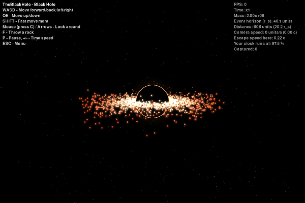
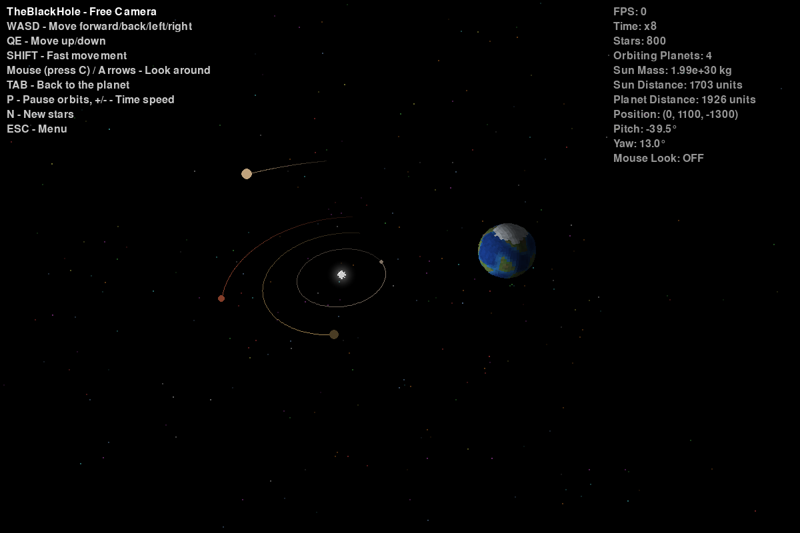
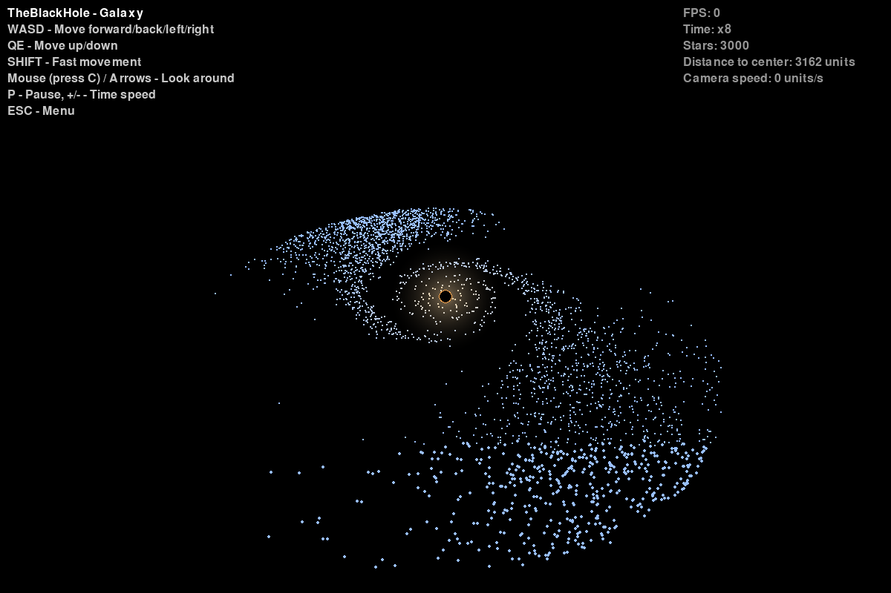
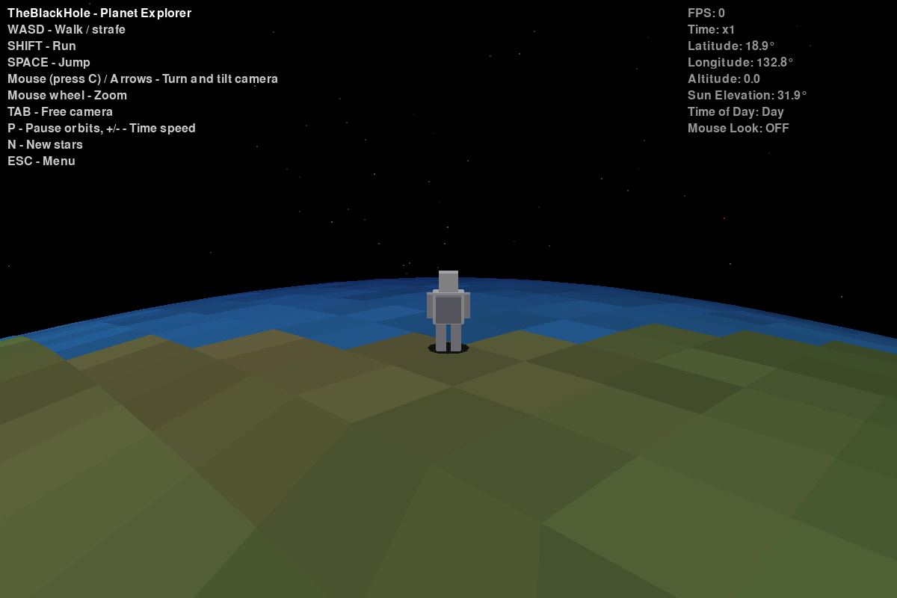

# TheBlackHole - 3D Space Simulation

[](https://github.com/francmarra/TheBlackHole/actions/workflows/ci.yml)

A 3D space simulation with a custom renderer and real N-body physics, written in Python with Pygame and NumPy (no OpenGL). Walk on a planet while the planets orbit the Sun, fly around a black hole with an accretion disk and gravitational lensing, or watch the arms of a spiral galaxy wind up.



## Scenarios

| Solar System | Black Hole | Galaxy |
|---|---|---|
|  |  |  |
| Walk on a planet in third person while four planets orbit the Sun, leaving trails | An accretion disk spiralling into the event horizon, with lensed background stars | 3000 stars on a flat rotation curve: the spiral arms wind up as the galaxy turns |



## Features

### Physics
- **N-body gravity** with a **Velocity Verlet** integrator (symplectic, so the energy does not drift: 2.5e-5 error over ten eccentric orbits, against 28 % with explicit Euler; see `tests/test_physics.py`)
- **Vectorised with NumPy**: all pairwise forces are computed at once (about 60x faster than the Python loop at 100 bodies)
- **Planets in orbit** around the Sun, with **orbit trails**
- **Time control**: pause, speed up and slow down the simulation (x1/8 to x64)

### Black hole
- **Event horizon** from the Schwarzschild radius r_s = 2GM/c², and the dark **shadow** (~2.6 r_s) with a photon ring
- **Accretion disk** of 1500 particles that slowly lose speed and spiral in; anything that crosses the horizon is **captured**
- **Gravitational lensing** of the background stars (point lens: every star behind the hole splits into two images around the Einstein ring)
- **HUD** with the distance in r_s, the escape speed and the gravitational **time dilation** sqrt(1 - r_s/r)
- Throw rocks at it with **F**

### Galaxy
- Two **logarithmic spiral arms** of young blue stars around a yellow bulge and a central black hole
- A **flat rotation curve** (like the one dark matter gives real galaxies): inner stars go round faster, so the arms wind up

### Renderer (written from scratch)
- Perspective camera stored as right/up/forward vectors (third person and free-fly)
- Cube-sphere planet mesh, back-face culling, painter's algorithm and flat shading with day and night
- **Near-plane clipping** in 3D, then **screen clipping** (Sutherland-Hodgman) in 2D: faces cut by the near plane can project tens of thousands of pixels away, and trimming them halved the frame time
- Additive **glow** sprites for the Sun, the accretion disk and the photon ring

## Controls

Start the program and pick a scenario in the menu (**Up/Down + Enter** or **1-3**). **ESC** goes back to the menu, and **ESC** in the menu quits.

### Solar System: on the planet
- **WASD**: walk and strafe, **SHIFT**: run, **SPACE**: jump
- **Mouse** (press **C** to capture it) or **Arrow Keys**: turn and tilt the camera, **Mouse Wheel**: zoom
- **TAB**: switch to the free camera and back

### Free camera (all scenarios)
- **WASD**: move, **Q/E**: up and down, **SHIFT**: 5x faster
- **Mouse** (press **C**) or **Arrow Keys**: look around

### Everywhere
- **P**: pause, **+/-**: faster or slower time
- **F** (black hole): throw a rock
- **N** (Solar System): new random star field

## Installation and running

Python 3.10 or newer:

```bash
pip install -e .
theblackhole
```

or, without installing:

```bash
pip install -r requirements.txt
cd src
python -m theblackhole
```

The original 2D version is still in `space_simulation.py`.

## Development

```bash
pip install -e ".[dev]"
pytest -q          # 47 tests: camera, physics, energy, orbits, black hole, lensing, galaxy, clipping
ruff check .
python scripts/profile_frames.py   # ms per frame and a cProfile report, without a window
python scripts/capture.py          # regenerates the images in docs/images
```

GitHub Actions runs `ruff` and `pytest` on every push and pull request.

## Project structure

- `src/theblackhole/`
  - `main.py` - start menu, scenarios, input, cameras and HUD
  - `config.py` - every tuning constant
  - `camera.py` - camera and projection
  - `render.py` - near-plane and screen clipping, painter's algorithm, shading
  - `physics.py` - `Body` and the vectorised `GravitySystem` (Velocity Verlet, energy, momentum)
  - `solar_system.py` - planets orbiting the Sun, with trails
  - `blackhole.py` - black hole, accretion disk, lensing, captures and HUD numbers
  - `galaxy.py` - spiral galaxy on a flat rotation curve
  - `glow.py` - additive glow sprites
  - `timecontrol.py` - pause and simulation speed
  - `star.py`, `sun.py`, `starfield.py` - stars, the Sun and the star field
  - `planet.py`, `player.py` - the planet mesh and the astronaut
- `tests/` - pytest suite
- `scripts/` - profiling and screenshot tools
- `ROADMAP.md` - the 28-day plan and progress log

## Units

The simulation uses scene units, not SI: G = 1 and the speed of light is 316 units/s, chosen so that the orbits, the horizon and the lensing are all visible on screen. The formulas are the real ones (`tests/test_blackhole.py` checks the Schwarzschild radius of the Sun in SI units).
